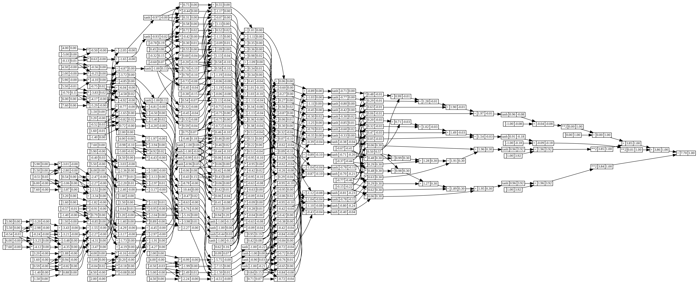

# nanograd
A tiny scalar-valued autograd engine with backprop and a small neural network library, built from scratch in Python.

# nanograd 🧠

**Backpropagation from scratch in pure Python.**

A tiny autograd engine and neural network library, built to understand what `loss.backward()` actually does.



*Computation graph of the loss for a small MLP. Every node stores its value and its gradient.*

## The idea

Every number is wrapped in a `Value` that remembers how it was made. Do some math, call `.backward()`, and every value learns how much it affected the result.

```python
a = Value(2.0, label='a')
b = Value(-3.0, label='b')
c = Value(10.0, label='c')
f = Value(-2.0, label='f')

L = (a * b + c) * f
L.backward()

print(a.grad)  #  6.0
print(b.grad)  # -4.0
print(c.grad)  # -2.0
print(f.grad)  #  4.0
```

## What's inside

- **`Value`**: scalar autograd engine with reverse-mode autodiff
- **Operations**: `+`, `-`, `*`, `/`, `**`, negation, `tanh`, `exp`
- **`Neuron` → `Layer` → `MLP`**: a small neural network library built on `Value`
- **`draw_dot()`**: draws any computation graph with `data` and `grad` on every node
- **Training loop**: gradient descent on a 4-sample dataset

## How it works

1. **Forward pass:** each operation creates a new `Value` and records its inputs and the operation.
2. **Backward pass:** `backward()` sorts the graph topologically, sets the output gradient to `1.0`, and calls each node's `_backward()` in reverse order. Gradients are added with `+=`, so a value used more than once gets the correct total.
3. **Update:** every parameter moves a small step against its gradient to reduce the loss.

## Training an MLP

```python
xs = [
  [5.9, 3.2, 4.0],
  [6.0, -1.4, 4.5],
  [5.5, 1.6, -5.0],
  [7.6, 1.5, 2.0],
]
ys = [1.0, -1.0, 1.0, -1.0]   # desired targets

n = MLP(3, [4, 4, 1])         # 3 inputs, two hidden layers of 4, 1 output

for i in range(10):

  # forward pass
  ypred = [n(x) for x in xs]
  loss = sum((yout - ygt)**2 for ygt, yout in zip(ys, ypred))

  # backward pass
  for p in n.parameters():
    p.grad = 0
  loss.backward()

  # update
  for p in n.parameters():
    p.data += -0.01 * p.grad

  print(i, loss.data)
```

```
0 7.785058953632191
1 7.7779230300579165
...
100 0.09066279548725514
```

The loss goes down every step.

## What I learned

- Backpropagation is the chain rule applied node by node over a computation graph
- Each operation only needs to know its own local derivative
- Gradients must be accumulated (`+=`) and zeroed before every backward pass
- With large inputs, `tanh` saturates and its gradient is almost 0, so training crawls
- Python dunder methods (`__add__`, `__mul__`, `__radd__`, `__call__`) let a custom class behave like a number


